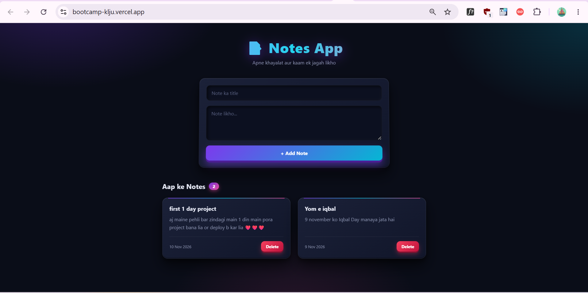

# Notes App

A full-stack notes app with a dark 3D UI.

## Live Demo
https://bootcamp-klju.vercel.app/

## Tech Stack
- Frontend: React (Vite), Axios
- Backend: Node.js, Express
- Database: MongoDB Atlas (Mongoose)
- Deployment: Vercel

## Features
- Add notes
- View all notes
- Delete notes

## Run Locally
1. `cd backend` → `npm install` → create `.env` with `MONGO_URI` and `PORT` → `npm run dev`
2. `cd frontend` → `npm install` → create `.env` with `VITE_API_URL` → `npm run dev`

